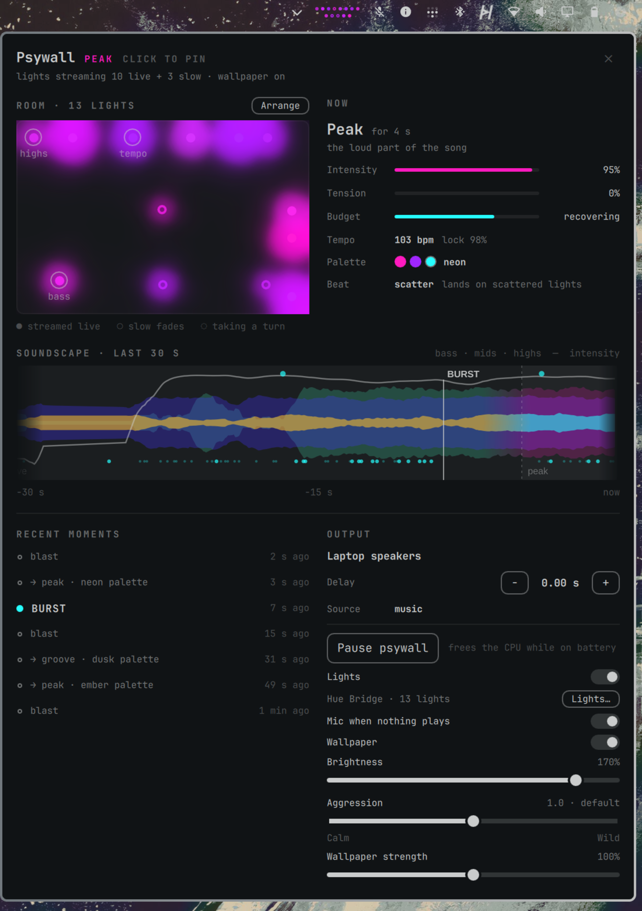

# Psywall

Your wallpaper and your Philips Hue lights, moving to whatever's playing.



- **The wallpaper.** A subtle oil-slick tint flows through the dark parts of
  your wallpaper, following the bass, mids and highs. The light parts stay
  as they are, it switches off over fullscreen windows, and it stops
  drawing entirely when nothing is playing.
- **The lights.** Up to 10 Hue lights stream 50 times a second, and the beat
  is handed around the room instead of everything pulsing at once. Palettes
  sweep across the room, drops and builds get rationed big moments, and
  each light can be **Beat**, **Dynamic** or **Glow**. When the music stops,
  every light goes back to exactly how it was.
- **The card.** A live miniature of your lights sits in the bar: one dot per
  paired light, in its current colour. Click it for the room map, the show's
  state, a 30-second soundscape, recent big moments and the controls.
  Pairing, choosing lights and placing them all happen in the card.

## Requirements

- Omarchy 4 (the Quickshell shell, Quickshell 0.3.x) on Hyprland.
- `python-numpy`. Everything else ships with Omarchy: PipeWire, Python,
  ImageMagick, Avahi and OpenSSL. If numpy is missing, the card says so and
  its **Install** button runs `omarchy-pkg-add python-numpy` in a terminal,
  where you see the password prompt yourself.
- For the lights: a Hue Bridge (the square second-generation one, or a Hue
  Bridge Pro) and colour lights that support Hue Entertainment, which is
  nearly every colour bulb, strip and lamp sold since 2016. White-only
  bulbs are listed but never touched. The original round bridge is not
  supported.

## Install

### 1. Install

#### Via the marketplace

Find Psywall in the [Omarchy Plugin Marketplace](https://omarchyplugins.com/)
and run its install command:

```bash
omarchy plugin add https://github.com/dragosol/omarchy-psywall.git
```

#### Via Git

```bash
git clone https://github.com/dragosol/omarchy-psywall.git \
  ~/.config/omarchy/plugins/io.github.dragosol.psywall
```

### 2. Enable

```bash
omarchy-shell shell rescanPlugins
omarchy plugin enable io.github.dragosol.psywall --section right
omarchy restart shell
```

The wallpaper effect starts with the next song.

### 3. Connect your Hue lights (optional)

Click the Psywall dots in the bar, then **Connect Hue lights**.

1. **Bridge.** Bridges on your network are found automatically. If none
   shows up, type the bridge's IP address; the Hue app shows it under
   Settings → Bridges → ⓘ.
2. **Link button.** Press the round button on top of the bridge. The card
   waits two minutes, so there's time to walk over.
3. **Lights.** Choose a mode for each colour light, or pick an
   entertainment area you already made in the Hue app:
   - **Beat** takes the rhythm. Beat lights take turns on every beat and
     get the accents first, so they flash on the hits.
   - **Dynamic** lets the show decide: slow drift, a turn on the beat now
     and then, accents, and the big moments. This is the default.
   - **Glow** is ambient colour that follows the palette, with no beats.
   - **Off** leaves the light alone.

   A Hue bridge streams at most 10 lights at once, from one entertainment
   area. So up to 10 lights can be Beat or Dynamic. Glow lights use any
   live slots that are left, and any beyond that follow the show with
   slower fades. Psywall makes an entertainment area called "Psywall" for
   you, unless you picked one of yours.
4. **Place them.** The room map opens in arrange mode. Click a light and it
   blinks in your room, even while music is playing, then drag it to where
   it stands. The show uses these places: palettes sweep across the room in
   that order, the beat walks from neighbour to neighbour, and hits ripple
   outwards. Click **Arrange** any time to move them again.

**Lights…** in the card goes back to the light choices. From there,
**Pair another bridge** pairs a different bridge or re-pairs this one;
the current pairing stays until the new one succeeds. **Forget** deletes the
key from this computer.

## Using it

The bar widget shows one dot per paired light: filled for lights streamed
live, rings for slow-fade lights. They glow in the lights' live colours
while the show runs. With no lights paired, it shows a bulb.

Hover the widget for a preview, or click it to pin the card. Escape, ×, or
another click closes it. The card has:

- **Room**: every light where you placed it, glowing in its current colour.
  A ring marks a light that's taking its turn following the tempo or one
  part of the spectrum.
- **Now**: the section (breakdown, groove, peak), intensity, tension, the
  big-moment budget, tempo and palette.
- **Soundscape**: the last 30 seconds of bass, mids, highs and intensity,
  with the big moments marked.
- **Output**: the playback device and its **delay**. Over AirPlay the sound
  arrives a second or two late, so the wallpaper and lights wait to match.
  The delay is remembered per device.
- **Controls**: pause everything, lights on/off, the microphone fallback,
  wallpaper on/off, light brightness, how aggressive the big moments are,
  and wallpaper strength.

Settings live in `~/.config/omarchy/psywall.json`. Everything is also
scriptable:

```bash
omarchy-shell psywall toggle | toggleHue | toggleWallpaper | toggleMic | status
omarchy-shell psywall hueStrength 1.5 | aggression 0.5 | strength 1 | delay 2.1
omarchy-shell psywall-view toggle | setup | arrange
```

## Privacy and security

- **Audio stays on this computer.** Psywall reads the level of what's
  playing, about 60 numbers a second, from PipeWire's monitor of your output
  device. Nothing is recorded, saved or sent anywhere.
- **The microphone is off unless you turn it on.** With **Mic when nothing
  plays** switched on, Psywall listens to the room when nothing is playing,
  and only the wallpaper reacts to it. The lights follow music, never the
  microphone.
- **The Hue key.** Pairing gives Psywall an application key and a streaming
  key. They're stored in `~/.config/psywall/hue.json`, created with mode 0600
  in a 0700 directory. They are never put on a command line, where other
  accounts on the machine could read them in `/proc`. Streaming uses DTLS
  inside Psywall's own process, through the system's libssl. Anyone who
  can read your home directory, or a backup of it, can read the key, the
  same as with any app's saved login.
- **Only your bridge.** Psywall only connects to IP addresses on your local
  network, never to a hostname or a public address. The bridge's TLS
  certificate is recorded when you pair (trust on first use: Hue bridges
  carry certificates issued to the bridge rather than to an address, so
  ordinary hostname checks can't apply). Every later connection must present
  that same certificate before anything is sent, so a device that takes over
  the bridge's address afterwards gets nothing. What this can't cover is a
  device impersonating the bridge during the two minutes you're pairing;
  pair on a network you trust.
- **Discovery.** Bridges are found with mDNS on your local network. Only if
  that finds nothing does Psywall ask Signify's discovery service
  (`discovery.meethue.com`) which bridges are registered from your public IP
  address. That's the only request that leaves your network.
- **Your lights come back.** Before taking over, Psywall saves the state of
  every light it will touch. When the music stops, the lights are switched
  off in the card, or the shell restarts, a separate process puts each light
  back. That works even if Psywall itself is killed.
- **Bridge-supplied names** (lights, rooms, areas, bridges) are shown as
  plain text and never interpreted as markup.

## Updates

```bash
git -C ~/.config/omarchy/plugins/io.github.dragosol.psywall pull --ff-only
omarchy restart shell
```

## Remove

```bash
omarchy plugin disable io.github.dragosol.psywall
omarchy plugin remove io.github.dragosol.psywall
omarchy restart shell
```

Then, to delete everything Psywall stored:

```bash
rm -rf ~/.config/psywall ~/.config/omarchy/psywall.json
```

The bridge still remembers that an app called `psywall#<your computer>` was
paired, but without the deleted key that entry can't do anything. The
entertainment area called "Psywall" can be deleted in the Hue app.

## Troubleshooting

- **"lights resting"**: lights only run while music plays. Wait a few
  seconds after pressing play.
- **The bridge isn't found**: check that the computer and the bridge are on
  the same network (not a guest network), then type its IP address.
- **"the bridge's certificate changed since pairing"**: the bridge was
  replaced or reset, or something else answered at its address. Pair again
  from **Lights… → Pair another bridge**.
- **Hue Sync or another app is streaming**: a bridge streams one area at a
  time. Psywall takes over when music plays; stop the other app if you want
  it to keep the lights.

## License

MIT. See [LICENSE](LICENSE).
